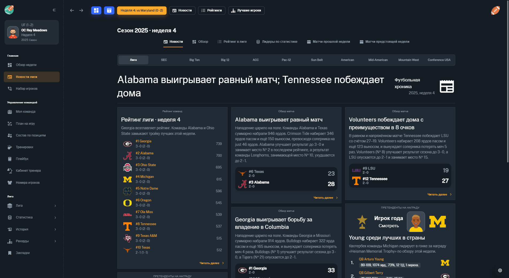

# Football Coach: College Dynasty — русификатор

[](https://github.com/supervi5w4/football-coach-college-dynasty-ru/actions/workflows/check.yml)


Неофициальный русский перевод **Football Coach: College Dynasty**, менеджера студенческой команды по **американскому футболу**.

**[Скачать русификатор 0.2.0](https://github.com/supervi5w4/football-coach-college-dynasty-ru/raw/refs/heads/main/packages/FCCD-RU-0.2.0.zip)** · [Релизы](https://github.com/supervi5w4/football-coach-college-dynasty-ru/releases) · [История изменений](CHANGELOG.md) · [Сообщить о проблеме](https://github.com/supervi5w4/football-coach-college-dynasty-ru/issues/new/choose)

Скачивайте **FCCD-RU-0.2.0.zip**. Кнопка GitHub «Code → Download ZIP» скачивает исходники проекта; готовый установочный архив находится в папке `packages`.



## Совместимость

| Параметр | Поддерживаемая версия |
|---|---|
| Игра | Football Coach: College Dynasty |
| Steam App ID | 2151290 |
| Версия игры | **1.6.5** |
| Сборка Steam | **19732424** |
| Система | Windows |
| Версия перевода | **0.2.0** |

Нужна установленная [игра в Steam](https://store.steampowered.com/app/2151290/Football_Coach_College_Dynasty/). Пакет содержит патч; полная игра, игровые сохранения и исполняемый файл игры в репозиторий не включены. Совместимость с другими сборками не заявлена: установщик проверяет SHA-256 и отказывается изменять неизвестный архив.

## Что переведено

- Меню, создание карьеры, настройки и обучение.
- Состав по позициям, карточки игроков, характеристики и тренерский штаб.
- Набор игроков, просмотр кандидатов, предложения, визиты и NIL.
- Экран матча, статистика, комментарии к розыгрышам, комбинации и построения.
- Новости, обзоры и анонсы матчей, рейтинги и гонки за награды.
- Межсезонные события, переговоры, контракты и цели спонсоров.
- Все игровые подсказки и длинные пояснения, включённые в словарь этой версии.

В словаре **4 987 записей и 1 151 шаблон** с подстановкой имён, чисел и сумм. Имена людей, команд, университетов, городов, конференций и наград оставлены в оригинале. Сохранены обозначения позиций вроде QB/RB/WR. Пользовательские тексты модов и будущие обновления могут содержать английский текст.

Терминология проверена отдельно: **[глоссарий американского футбола](docs/TERMINOLOGY.md)**. Например, depth chart — состав по позициям, extra point — одноочковая реализация, fair catch — свободная ловля; фамбл и мафф различаются.

## Установка

1. Скачайте **[FCCD-RU-0.2.0.zip](https://github.com/supervi5w4/football-coach-college-dynasty-ru/raw/refs/heads/main/packages/FCCD-RU-0.2.0.zip)** и распакуйте **весь архив** в отдельную папку.
2. Полностью закройте игру.
3. Запустите **`INSTALL.cmd`** из распакованной папки.
4. Дождитесь сообщения об успешной установке и запускайте игру через Steam.

Установщик находит игру в библиотеках Steam и создаёт резервную копию оригинального архива. Дополнительные программы для установки не нужны: используется встроенный Windows PowerShell.

Если папка игры не определяется автоматически, откройте командную строку в папке патча и укажите путь:

```bat
INSTALL.cmd "D:\SteamLibrary\steamapps\common\Football Coach College Dynasty"
```

## Обновление с 0.1.0

Закройте игру и запустите `INSTALL.cmd` из версии 0.2.0. Установщик использует уже созданную и проверенную резервную копию. Отдельно удалять старый перевод не требуется.

## Откат к английской версии

Закройте игру и запустите **`RESTORE.cmd`**. Он восстановит оригинальный `app.asar`. `STATUS.cmd` показывает текущее состояние установки.

Оригинальная резервная копия остаётся в папке игры:

```text
resources/app.asar.fccd-ru.original
```

Сохраните её для последующего отката. Если она потеряна, оригинальные файлы можно восстановить через Steam: свойства игры → установленные файлы → проверка целостности.

## Если установка не проходит

| Сообщение или ситуация | Что сделать |
|---|---|
| Игра запущена | Полностью закройте игру и повторите установку. |
| Неподдерживаемый архив | Сверьте версию игры. Другой мод или обновление Steam могут менять архив. Не обходите проверку хеша. |
| Не найдена резервная копия при обновлении | Восстановите оригинальные файлы через Steam, затем установите патч заново. |
| Файлы патча не прошли проверку | Скачайте и распакуйте ZIP заново целиком. |
| После обновления Steam язык снова английский | Проверьте совместимость новой сборки перед повторной установкой. |
| Найдена английская фраза или неверный термин | Создайте issue с текстом, экраном и версией игры. |

## Проверки

Перевод проверен на отдельной копии игры с отдельным профилем: загрузка сохранения, новости, все игровые подсказки, набор игроков, матч до финального свистка и переход на следующую неделю. Проверены установка, повторная установка, обновление с 0.1.0, откат и повторная установка после отката.

Автоматически проверяются **1 151 шаблон**, **63 проверки форматов и терминов**, составные новости, соответствие исходников готовому ZIP и контрольные суммы. Редкие ветки событий проверены по шаблонам; все возможные сценарии целого сезона вручную не проигрывались. [Отчёт проверки 0.2.0](docs/validation-0.2.0.json).

Контрольная сумма скачанного архива: [SHA256SUMS.txt](packages/SHA256SUMS.txt).

## Исходники и участие

Словари находятся в `src/literals.json` и `src/templates.json`, движок перевода — в `src/fccd-ru.js`. В шаблонах нужно сохранять все маркеры `{0}`, `{1}` и т. д. [Сборка, проверки и правила правок](CONTRIBUTING.md).

Проект не связан с разработчиком игры и Valve. Лицензия собственного кода проекта — [MIT](LICENSE); права на материалы игры сохраняются за их правообладателями, см. [NOTICE](NOTICE.md).

